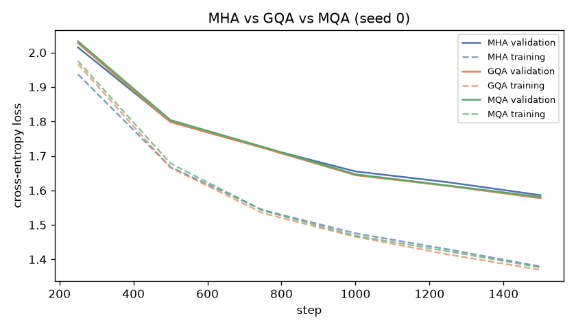

# LLaMA 2 From Scratch in PyTorch

A small LLaMA 2-style language model implemented and trained from scratch in PyTorch.

I built this project to understand the architecture at the code level instead of starting with a pretrained model. I first implemented the model with Multi-Head Attention (MHA), then modified the attention layer to use Grouped-Query Attention (GQA).

The model is trained on Tiny Shakespeare for character-level next-token prediction.

## What I Implemented

The model includes:

- Token embeddings
- RMSNorm
- Rotary Positional Embeddings (RoPE)
- Causal self-attention
- Multi-Head Attention (MHA)
- Grouped-Query Attention (GQA)
- SwiGLU feed-forward layers
- Residual connections
- Transformer blocks
- Language modeling head
- Autoregressive text generation

The overall model flow is:

`tokens → embeddings → transformer blocks → RMSNorm → LM head → logits`

Each transformer block follows:

`RMSNorm → Attention → Residual → RMSNorm → SwiGLU → Residual`

## MHA Implementation

I started with standard multi-head attention.

For the current model configuration:

```text
dim = 256
n_heads = 8
head_dim = 32
```

MHA uses the same number of query, key, and value heads:

```text
Q heads = 8
K heads = 8
V heads = 8
```

The Q, K, and V projections therefore each produce 256-dimensional outputs.

## GQA Implementation

I then changed the attention layer to Grouped-Query Attention while keeping the rest of the model largely unchanged.

The GQA configuration uses:

```text
Query heads = 8
Key heads   = 2
Value heads = 2
```

Since there are 8 query heads and 2 KV heads, each KV head is shared by 4 query heads.

With a head dimension of 32:

```text
Q projection: 256 → 256
K projection: 256 → 64
V projection: 256 → 64
```

The K and V heads are repeated across their corresponding query groups during attention computation.

This allowed me to experiment with the difference between MHA and GQA without changing the rest of the Transformer architecture.

## Training

Both models are trained from random initialization using Tiny Shakespeare.

I used a simple character-level tokenizer, where every unique character in the dataset is mapped to an integer ID.

Training uses:

- Cross-entropy loss
- AdamW optimizer
- Random sequence batches
- Autoregressive next-token prediction
- GPU training with PyTorch/CUDA

## GQA Training Results

The GQA model was trained for 10,000 optimization steps.

Some checkpoints from the run:

| Step | Loss |
|---:|---:|
| 0 | 4.3485 |
| 100 | 2.3423 |
| 500 | 1.5930 |
| 1,000 | 1.4043 |
| 2,000 | 1.2734 |
| 3,000 | 1.2000 |
| 5,000 | 1.1233 |
| 7,000 | 1.0051 |
| 8,000 | 0.8425 |
| 9,000 | 0.8066 |
| 9,900 | 0.7567 |

The training loss decreased from **4.3485 to 0.7567** during the run.

On held-out text, the final **validation loss was 1.9855**. The gap between training loss (0.76) and validation loss (1.99) shows the model overfits this small dataset, which is expected for a 3.8M-parameter model trained for 10,000 steps on Tiny Shakespeare. Adding dropout, early stopping on validation loss, or more data are natural next steps.

Loss does not decrease monotonically because each step uses a randomly sampled batch.

## Sample Generation

Prompt:

```text
ROMEO:
```

Sample output from the trained GQA model:

```text
ROMEO:
So, sometimes cannot this young modest girl: our knowledge
h not a lonted and at iddeed from consul:
How canst thou, or thou beest, Romeo:
There lie shall, as yours, perforce hath appear,
Which I'll figght again, methought, death,
Still cold again, and true Romeo;
This is the duke's of their perfection oQnwaring,
That will she, brave Bolingbroke, can her son,
But stirn you get thine here's some belonging;
```

The model is intentionally small and uses character-level tokenization, so the generated text still contains malformed words. The goal here is to study the architecture and training process rather than produce production-quality language generation.

## MHA vs GQA

The main architectural difference in this experiment is the number of key/value heads.

| | MHA | GQA |
|---|---:|---:|
| Query heads | 8 | 8 |
| Key heads | 8 | 2 |
| Value heads | 8 | 2 |
| Query heads per KV head | 1 | 4 |
| Head dimension | 32 | 32 |

I kept the model dimension, Transformer structure, dataset, and training pipeline the same so I could isolate the attention change.

## Controlled Comparison: MHA vs GQA vs MQA

The notebook implements both attention variants; `compare.py` now measures the difference. Only `n_kv_heads` changes between runs. The data, training batches (seeded), initialization seed, optimizer and number of steps are identical, and every variant is scored on the same fixed validation batches. The model code lives in `llama/model.py` and adds a **KV cache**, which is where GQA's savings show up during generation.

Results from a CPU run (1,500 steps, 1 seed):

| | MHA (8 KV heads) | GQA (2 KV heads) | MQA (1 KV head) |
|---|---:|---:|---:|
| Total parameters | 4,229,888 | 3,836,672 | 3,771,136 |
| Attention parameters | 1,048,576 | 655,360 | 589,824 |
| KV cache per token (fp32) | 8,192 bytes | 2,048 bytes | 1,024 bytes |
| KV cache after a 128-token prompt + 256 generated tokens (measured) | 3,064 KB | 766 KB | 383 KB |
| Training time per step | 429 ms | 339 ms | 330 ms |
| Generation with KV cache | 407 tokens/s | 489 tokens/s | 520 tokens/s |
| Generation without cache | 47 tokens/s | 55 tokens/s | 51 tokens/s |
| Final validation loss | 1.5861 | 1.5772 | 1.5811 |



**What the results show**

1. **GQA cuts the KV cache by exactly n_heads / n_kv_heads.** With 2 KV heads instead of 8, the cache is 4x smaller, both by formula and as measured after generation. The tests check this.
2. **At this scale, quality is unchanged.** Validation losses differ by less than 0.01, which is within what a single seed can tell apart. Claiming one variant is better would need several seeds.
3. **The KV cache matters more than the variant for speed.** Generating with the cache is about 8 to 10 times faster than recomputing attention over the whole sequence for every new token.
4. **The savings become large at real model sizes.** For one 4,096-token sequence with LLaMA-2-7B dimensions (32 layers, head size 128, fp16), the KV cache is 2.00 GB with 32 KV heads, 0.50 GB with 8 (GQA) and 0.06 GB with 1 (MQA). That is calculated, not measured here, and it is why large models adopted GQA: it lets a GPU serve more sequences at once.

**Overfitting check.** In this 1,500-step run, validation loss was still improving at the end, so these models are not yet overfitting. The original 10,000-step notebook run reached 0.76 training vs. 1.99 validation loss, so the overfitting appears somewhere between those points; `compare.py` records the step with the best validation loss to locate it.

**Limits of this run:** one seed, CPU only, 1,500 steps. To strengthen the comparison:

```
python compare.py --steps 10000 --seeds 0 1 2 --device cuda --mlflow
```

### Run it

```
pip install -r requirements.txt
python compare.py              # writes results/mha_vs_gqa.{md,json,png}
pytest -q                      # 11 tests
```

The tests check that the causal mask hides future tokens, that generating with the KV cache gives the same outputs as a full forward pass, that GQA removes exactly the expected key/value parameters, and that the measured cache size matches the formula.

## Next Experiments

- Repeat the comparison with 3 seeds and 10,000 steps on a GPU, and report means and standard deviations
- Add dropout or early stopping on validation loss to address the overfitting seen in the 10,000-step run
- BPE/subword tokenization
- Temperature and top-k sampling

## Tech Stack

- Python
- PyTorch
- CUDA
- Kaggle

## Notes

This is a small educational implementation inspired by the LLaMA 2 architecture. It is not the official LLaMA 2 implementation or a reproduction of Meta's pretrained models.

The purpose of the project is to understand the architecture by implementing, training, modifying, and comparing its components directly.
